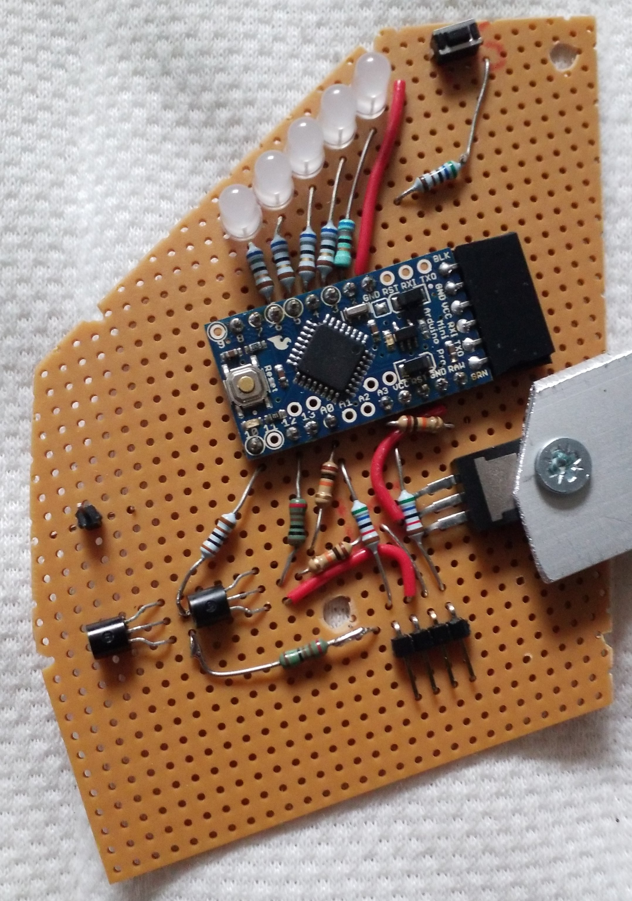

# Arduino HDQ Mock BMS

Arduino firmware for a mock Panasonic-style battery management system (BMS). The firmware emits the recorded HDQ presence heartbeat needed by the bike controller and implements battery state-of-charge display, charger detection, charger control, and button handling on an Arduino-compatible board.

**Why would you want to mock a BMS?**

I got a 15 year old e-bike with a worn out Li-ion Mn battery (NKY281B2 10Ah 259Wh).
I replaced the cells with new ones plus a new BMS. In order for this new combination
to play along with the e-bike you need to feed the proper electrical signals on the
"HDQ"-bus, so that the e-bike controller & motor can play along.

Background information:
- [Texas Instruments "HDQ Communication Basics"](https://www.ti.com/lit/an/slua408a/slua408a.pdf)
- [OpenBattery infos about 26V Panasonic NKY](https://open-battery.org/docs/panasonic/26v-premium-nky-stb/)


## Prerequisites

- Arduino CLI, available as `arduino` in `PATH` (for firmware verification and upload).
- An Arduino Nano or compatible ATmega328P board.
- A C++17 compiler.
- CMake 3.14 or newer.
- GoogleTest available as a CMake package (`find_package(GTest CONFIG REQUIRED)`).
- For hardware use: an HDQ bus with its pull-up, a logic-level N-FET, and a shared ground. The sketch must never drive the HDQ line high.

## Quick start

Clone the repository and enter the project directory:

```sh
git clone <repository-url>
cd arduino-hdq-mock-bms
```

Run the host-side test suite:

```sh
make tests
```

Verify the Arduino sketch:

```sh
make verify
```

Upload it to the default board and port:

```sh
make upload
```

The default upload configuration targets an Arduino Nano-compatible ATmega328P using the old bootloader on `/dev/ttyUSB1`.

## Configuration

Firmware and build settings are configured through `Makefile` variables. Override them on the command line:

| Name | Required | Default | Purpose |
| --- | --- | --- | --- |
| `ARDUINO` | No | `arduino` | Arduino CLI executable. |
| `SKETCH` | No | `arduino-hdq-mock-bms.ino` | Sketch passed to Arduino CLI. |
| `BOARD` | No | `arduino:avr:pro:cpu=16MHzatmega328` | Board identifier used by `make verify` and `make upload`. |
| `DEV_BOARD` | No | `arduino:avr:nano:cpu=atmega328old` | Development-board identifier retained in the Makefile. |
| `PORT` | No | `/dev/ttyUSB1` | Serial port used for upload. |

Example:

```sh
make upload PORT=/dev/ttyUSB0 BOARD=arduino:avr:nano:cpu=atmega328old
```

The sketch uses these fixed hardware mappings:

- HDQ output: digital pin 12
- Status LEDs: digital pins 6, 5, 4, 3, and 2
- Charger output: digital pin 10
- Button input: digital pin 7 using `INPUT_PULLUP`
- Battery voltage input: `A3`
- T/ID voltage input: `A0`



## Project structure

```text
.
├── arduino-hdq-mock-bms.ino   # Arduino entry point and HDQ heartbeat replay
├── ArduinoBoard.h              # Hardware abstraction for board inputs/outputs
├── MockBatteryMgmtSystem.h/.cpp# Mock BMS behavior
├── MovingAverage.h             # Voltage sampling helper
├── StableDigitalInput.h        # Debounced digital input helper
├── tests/                      # GoogleTest unit tests
├── CMakeLists.txt              # Host test build
└── Makefile                    # Firmware verification, upload, and tests
```

## Development workflow

### Host tests

Configure, build, and run all tests with:

```sh
make tests
```

The command uses CMake to configure `build/`, builds `HdqMockBMS_tests`, and runs it with CTest. To run the already-configured test suite directly:

```sh
ctest --test-dir build --output-on-failure
```

### Firmware verification

Check that the sketch compiles for the configured Arduino target:

```sh
make verify
```

### Hardware upload and debugging

Upload with `make upload`, overriding `PORT` when necessary. The sketch opens serial output at `9600` baud and reports T/ID voltage readings. Use an Arduino serial monitor configured for 9600 baud when debugging hardware behavior.

## Testing

The test suite uses GoogleTest and exercises the board abstraction and mock BMS behavior, including:

- LED state-of-charge thresholds and low-charge blinking.
- Battery voltage to state-of-charge conversion.
- Button debouncing.
- T/ID charger detection.
- Charger activation and charge-limit behavior.
- Display enable/disable behavior.
- Moving-average voltage sampling.

GoogleTest must be discoverable by CMake. If configuration fails at `find_package(GTest CONFIG REQUIRED)`, install or expose a compatible GoogleTest CMake package before running `make tests`.

## Deployment

There is no automated deployment configuration. Deployment to a bike consists of wiring the open-drain HDQ interface, connecting the Arduino board, and uploading the sketch with `make upload`.

The HDQ interface requires an external transistor stage: connect the Arduino output to the gate of a logic-level N-FET through approximately 150 ohms, use a 100k gate pulldown, connect the drain to HDQ, connect the source to ground, and share ground with the battery/bus negative. Do not connect the Arduino pin directly as a push-pull driver to the HDQ bus or drive the bus high.

## Troubleshooting

### `make upload` cannot open the serial port

Check that the board is connected and determine its device path, then override `PORT`:

```sh
make upload PORT=/dev/ttyUSB0
```

### The sketch does not compile for the connected board

Verify the selected board identifier and override `BOARD` if the board differs from the default:

```sh
make verify BOARD=arduino:avr:nano:cpu=atmega328old
```

### `make tests` cannot find GoogleTest

Install GoogleTest or configure CMake with a prefix containing its package configuration. The project currently requires a CMake-configurable GoogleTest installation; exact installation steps are platform-specific (TODO: confirm with team).

### The bike controller does not detect the mock battery

Confirm the HDQ wiring, common ground, bus pull-up, transistor orientation, and that the circuit only pulls HDQ low. The sketch replays a heartbeat approximately every 499 ms when the battery is not detected as being in the charger.
